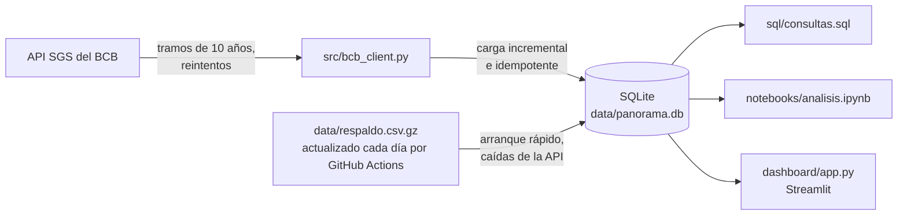

# Panorama económico de Brasil

[](https://github.com/tcpalbertvaldivia1993-lang/panorama-brasil/actions/workflows/tests.yml)
[](https://github.com/tcpalbertvaldivia1993-lang/panorama-brasil/actions/workflows/actualizar-respaldo.yml)

[English](README.md) | **Español**

Proyecto de punta a punta con datos públicos del **Banco Central de Brasil (BCB)**:
API → base de datos SQLite → notebook de análisis → dashboard interactivo en inglés, portugués y español.


## Hallazgos clave

Datos de enero de 2000 a octubre de 2026.

1. **Del mínimo histórico a la tasa más alta en casi 20 años.** La Selic meta bajó a un mínimo histórico de **2,00 %** (agosto de 2020 – marzo de 2021) y subió a **15,00 %** en junio de 2025, su nivel más alto desde julio de 2006. Hoy está en 13,75 %.
2. **Repunte de la inflación tras la pandemia.** El IPCA acumulado en 12 meses pasó de **1,88 %** en mayo de 2020 a **12,13 %** en abril de 2022, el más alto desde 2003. Desde el año 2000, la inflación anual solo superó el 10 % tres veces: 2002 (12,53 %), 2015 (10,67 %) y 2021 (10,06 %). Hoy está en 4,58 % (septiembre de 2026).
3. **De tasas reales negativas a muy altas.** La tasa real (Selic menos IPCA de 12 meses) fue negativa en 20 de los 22 meses entre julio de 2020 y abril de 2022, con un mínimo de **−4,7 p.p.** en julio de 2021. Después llegó a **11,2 p.p.** en febrero de 2026, la más alta desde junio de 2006.
4. **El real perdió casi dos tercios de su valor frente al dólar.** El tipo de cambio pasó de 1,80 BRL/USD en enero de 2000 a 5,04 en octubre de 2026 (+180 %). El real estuvo más fuerte en julio de 2011 (1,53) y más débil el 2 de enero de 2025 (6,21); desde entonces se recuperó un 19 %.


*Tasa real anual: Selic promedio menos el IPCA de ese año, en puntos porcentuales (el hallazgo 3 usa valores mensuales).*


## Arquitectura



## Datos

| Código SGS | Serie | Frecuencia |
|-----------:|-------|------------|
| 432 | Selic meta (% a.a.) | diaria |
| 433 | IPCA, variación mensual (%) | mensual |
| 1 | Dólar venta (BRL/USD) | días hábiles |

Fuente: API SGS del BCB, sin registro ni credenciales:
`https://api.bcb.gov.br/dados/serie/bcdata.sgs.{codigo}/dados?formato=json`

## Dashboard

- **Series:** último valor, máximo y mínimo de cada serie en el rango elegido, con su gráfico.
- **Selic vs. inflación:** Selic meta, IPCA acumulado en 12 meses y tasa real aproximada.
- **Promedio anual y datos:** promedios por año, datos filtrados y descarga en CSV.

En la barra lateral se eligen las series y el rango de fechas; arriba a la derecha está el selector de idioma (English, Português, Español).

| Series | Promedio anual y datos |
|---|---|
|  |  |

## Cómo ejecutarlo

Requiere Python 3.11 o superior.

```bash
git clone https://github.com/tcpalbertvaldivia1993-lang/panorama-brasil.git
cd panorama-brasil
python3 -m venv venv
venv/bin/pip install -r requirements.txt

venv/bin/python -m src.db                    # carga los datos en data/panorama.db
venv/bin/streamlit run dashboard/app.py      # dashboard en http://localhost:8501
venv/bin/jupyter notebook notebooks/analisis.ipynb
```

`python -m src.db` es **incremental** e **idempotente**: cada serie se pide solo desde su último dato (menos 60 días, por si el BCB corrigió algún valor reciente) y, si lo ejecutas dos veces, no duplica nada. Con la base vacía parte de `data/respaldo.csv.gz`, así que la primera carga tarda segundos. Para volver a descargar todo desde una fecha: `venv/bin/python -m src.db --desde 2015-01-01`.

### Publicarlo en Streamlit Community Cloud

La base no se sube al repositorio. Si el dashboard no la encuentra, la crea al instante desde `data/respaldo.csv.gz` y después busca datos nuevos en la API en segundo plano, como mucho cada 12 horas.

1. Entrar en https://share.streamlit.io con la cuenta de GitHub.
2. **Create app** → repositorio `panorama-brasil`, rama `main`, archivo `dashboard/app.py`.
3. En **Advanced settings**, elegir Python 3.12 y pulsar **Deploy**.

## Pruebas

```bash
venv/bin/pip install -r requirements-dev.txt
venv/bin/python -m pytest              # todas
venv/bin/python -m pytest -k tramos    # solo las que contienen "tramos" en el nombre
```

55 pruebas que nunca llaman a la API (simulan sus respuestas), así que son rápidas y no fallan si la API está caída. Cubren la división en tramos de 10 años, los reintentos, la conversión de fechas y valores, la carga idempotente e incremental, la creación segura de la base, el respaldo, la actualización en segundo plano, las consultas SQL, el IPCA acumulado y las traducciones del dashboard. GitHub Actions las ejecuta con Python 3.11 y 3.12 en cada push.

## Notas técnicas

- La API devuelve fechas `dd/mm/aaaa` y valores como texto; al cargar se convierten a fecha ISO y a número.
- Las series diarias aceptan como máximo **10 años por consulta**, por eso la descarga se hace por tramos.
- Ante errores de red, respuestas `503` o páginas que no son JSON, se reintenta con esperas crecientes.
- **Respaldo:** la API a veces no responde durante horas. Un GitHub Action programado descarga cada día los datos nuevos y actualiza `data/respaldo.csv.gz` (unos 60 KB), con un commit solo si los datos cambiaron. El dashboard y `python -m src.db` parten de él cuando no hay base. Para generarlo a mano: `venv/bin/python -m src.db --exportar-respaldo`.
- Tabla `series` de la base: `codigo` INTEGER, `nombre` TEXT, `fecha` TEXT (ISO), `valor` REAL, clave primaria (`codigo`, `fecha`).

```bash
sqlite3 data/panorama.db "SELECT fecha, valor FROM series WHERE codigo = 1 ORDER BY fecha DESC LIMIT 5;"
```

## Estructura

```
├── src/
│   ├── bcb_client.py   # descarga de series desde la API SGS
│   ├── db.py           # crea y actualiza la base, exporta el respaldo
│   └── consultas.py    # ejecuta por nombre las consultas de sql/consultas.sql
├── sql/
│   ├── schema.sql      # esquema de la tabla series
│   └── consultas.sql   # promedio anual, máximos/mínimos, variación mensual, IPCA anual
├── notebooks/
│   ├── analisis.ipynb  # análisis y gráficos
│   └── figuras/        # gráficos exportados y capturas del dashboard
├── dashboard/
│   ├── app.py          # dashboard de Streamlit
│   └── idiomas.py      # textos en inglés, portugués y español
├── tests/              # pruebas con pytest (sin conexión a la API)
├── data/
│   ├── panorama.db     # base SQLite (no se sube a GitHub)
│   └── respaldo.csv.gz # copia de los datos, actualizada cada día por GitHub Actions
└── .github/workflows/  # pruebas en cada push y respaldo diario
```

## Próximos pasos

- [ ] Tasa real exacta con la ecuación de Fisher
- [ ] Separar las dependencias del dashboard y las de desarrollo
- [ ] Más series: desempleo, CDI, IPCA oficial de 12 meses
