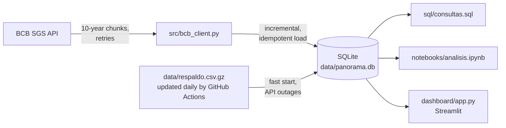

# Brazil Economic Overview

[](https://github.com/tcpalbertvaldivia1993-lang/panorama-brasil/actions/workflows/tests.yml)
[](https://github.com/tcpalbertvaldivia1993-lang/panorama-brasil/actions/workflows/actualizar-respaldo.yml)

**English** | [Español](README.es.md)

End-to-end data project with public data from the **Central Bank of Brazil (BCB)**:
API → SQLite database → analysis notebook → interactive dashboard in English, Portuguese and Spanish.


## Key findings

Data from January 2000 to October 2026.

1. **From a record low to the highest rate in almost 20 years.** The Selic target rate was cut to a record low of **2.00%** (August 2020 – March 2021), then raised to **15.00%** in June 2025, its highest level since July 2006. It is now 13.75%.
2. **Post-pandemic inflation spike.** 12-month inflation (IPCA) rose from **1.88%** in May 2020 to **12.13%** in April 2022, the highest since 2003. Since 2000, yearly inflation has only exceeded 10% three times: 2002 (12.53%), 2015 (10.67%) and 2021 (10.06%). It is now 4.58% (September 2026).
3. **From negative to very high real interest rates.** The real interest rate (Fisher equation: Selic target vs. 12-month IPCA) was negative in 20 of the 22 months between July 2020 and April 2022, bottoming at **−4.35%** in July 2021. It then peaked at **10.78%** in February 2026, the highest since June 2006. It is now 8.77%.
4. **The real lost almost two-thirds of its value against the dollar.** The exchange rate went from 1.80 BRL/USD in January 2000 to 5.04 in October 2026 (+180%). The real was strongest in July 2011 (1.53) and weakest on 2 January 2025 (6.21); since then it has recovered 19%.


*Selic target vs. 12-month IPCA; shaded: Selic below inflation. Charts come from the notebook, which is in Spanish.*


*Yearly real rate (Fisher equation) from the average Selic and that year's IPCA; 2026 covers January–September only. Finding 3 uses monthly values.*


*US dollar selling rate (BRL/USD).*

## Architecture



## Data

| SGS code | Series | Frequency |
|---------:|--------|-----------|
| 432 | Selic target rate (% per year) | daily |
| 433 | IPCA inflation, monthly change (%) | monthly |
| 1 | US dollar, selling rate (BRL/USD) | business days |

Source: BCB SGS API, no registration or credentials needed:
`https://api.bcb.gov.br/dados/serie/bcdata.sgs.{code}/dados?formato=json`

## Dashboard

- **Series:** latest value, maximum and minimum of each series in the selected range, with its chart.
- **Selic vs. inflation:** Selic target, 12-month IPCA and real interest rate.
- **Yearly average and data:** yearly averages, filtered data and CSV download.

Series and date range are chosen in the sidebar; the language selector (English, Português, Español) is at the top right.

| Series | Yearly average and data |
|---|---|
|  |  |

## Quick start

Requires Python 3.11 or newer.

```bash
git clone https://github.com/tcpalbertvaldivia1993-lang/panorama-brasil.git
cd panorama-brasil
python3 -m venv venv
venv/bin/pip install -r requirements.txt      # data loading and dashboard

venv/bin/python -m src.db                    # load the data into data/panorama.db
venv/bin/streamlit run dashboard/app.py      # dashboard at http://localhost:8501

venv/bin/pip install -r requirements-dev.txt  # adds Jupyter, matplotlib and pytest
venv/bin/jupyter notebook notebooks/analisis.ipynb
```

`requirements.txt` only has what the dashboard needs (37 packages), so Streamlit Cloud installs less than half of the full development environment (123 packages).

`python -m src.db` is **incremental** and **idempotent**: each series is only requested from its latest stored date (minus 60 days, in case the BCB revised recent values), and running it twice never duplicates rows. With an empty database it starts from `data/respaldo.csv.gz`, so the first load takes seconds. To download everything again from a given date: `venv/bin/python -m src.db --desde 2015-01-01`.

### Deploy on Streamlit Community Cloud

The database is not stored in the repository. When the dashboard does not find it, it builds it instantly from `data/respaldo.csv.gz` and then fetches new data from the API in the background, at most every 12 hours.

1. Sign in at https://share.streamlit.io with your GitHub account.
2. **Create app** → repository `panorama-brasil`, branch `main`, file `dashboard/app.py`.
3. Under **Advanced settings**, choose Python 3.12 and click **Deploy**.

## Tests

```bash
venv/bin/pip install -r requirements-dev.txt
venv/bin/python -m pytest
```

58 tests that never call the API (responses are simulated), so they are fast and do not fail when the API is down. They cover the 10-year chunking, retries, date and value conversion, idempotent and incremental loading, safe database creation, the backup file, the background update, the SQL queries, the 12-month IPCA compounding and the dashboard translations. GitHub Actions runs them on Python 3.11 and 3.12 on every push.

## Technical notes

- The API returns dates as `dd/mm/yyyy` and values as text; both are converted on load (ISO dates, floats).
- Daily series accept at most **10 years per request**, so downloads are split into chunks.
- Network errors, `503` responses and non-JSON pages are retried with increasing waits.
- **Real interest rate:** computed with the Fisher equation, `(1 + Selic) / (1 + IPCA) − 1`, in `tasa_real_fisher()` (`src/consultas.py`), shared by the notebook and the dashboard. The common shortcut `Selic − IPCA` overstates it when rates are high: today it would give 9.17 instead of 8.77%.
- **Backup:** the API sometimes stops responding for hours. A scheduled GitHub Action downloads new data every day and updates `data/respaldo.csv.gz` (about 60 KB), committing only when the data changed. The dashboard and `python -m src.db` start from it when there is no database.
- Database table `series`: `codigo` INTEGER, `nombre` TEXT, `fecha` TEXT (ISO), `valor` REAL, primary key (`codigo`, `fecha`).

```bash
sqlite3 data/panorama.db "SELECT fecha, valor FROM series WHERE codigo = 1 ORDER BY fecha DESC LIMIT 5;"
```

## Project structure

```
├── src/
│   ├── bcb_client.py   # downloads series from the SGS API
│   ├── db.py           # creates and updates the database, exports the backup
│   └── consultas.py    # runs the named queries in sql/consultas.sql
├── sql/
│   ├── schema.sql      # schema of the series table
│   └── consultas.sql   # yearly average, max/min, monthly change, yearly IPCA
├── notebooks/
│   ├── analisis.ipynb  # analysis and charts
│   └── figuras/        # exported charts and dashboard screenshots
├── dashboard/
│   ├── app.py          # Streamlit dashboard
│   └── idiomas.py      # texts in English, Portuguese and Spanish
├── tests/              # pytest tests (no API calls)
├── data/
│   ├── panorama.db     # SQLite database (not in the repository)
│   └── respaldo.csv.gz # data backup, updated daily by GitHub Actions
└── .github/workflows/  # tests on every push and daily data backup
```

The code, comments and notebook are written in Spanish.

## Roadmap

- [ ] More series: unemployment, CDI, official 12-month IPCA
