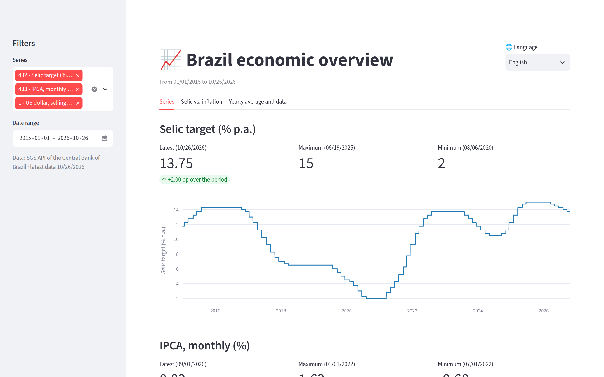
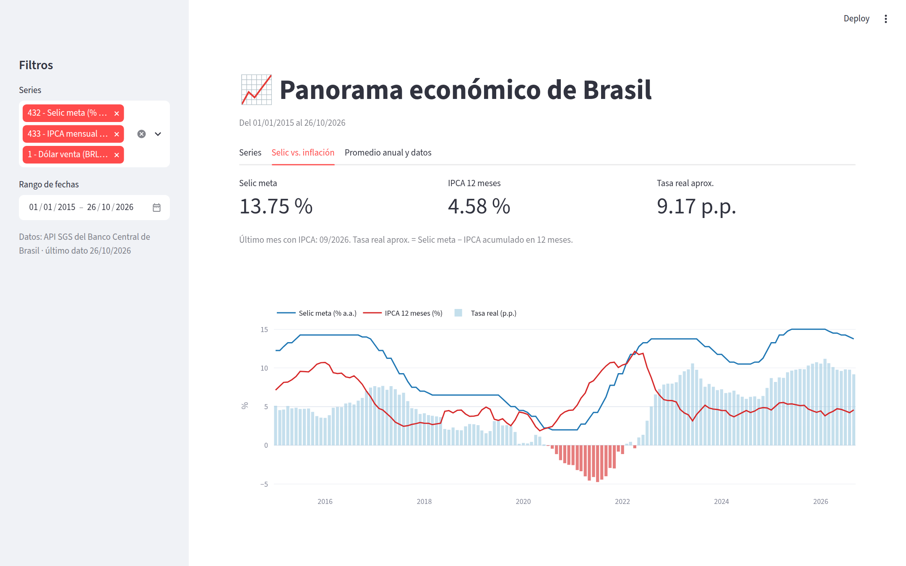
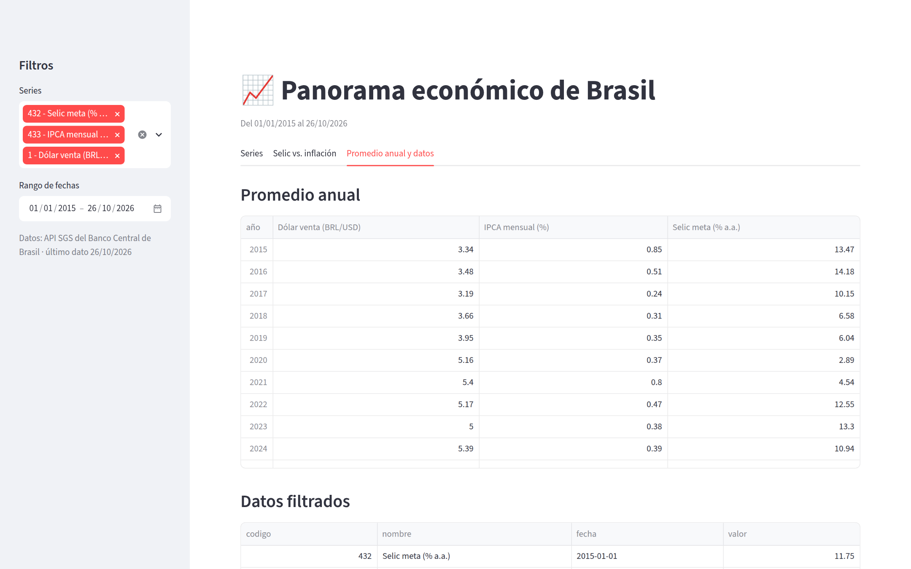
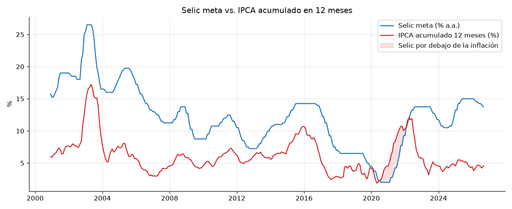
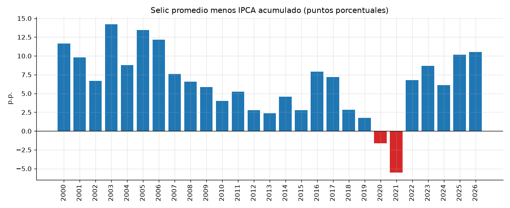
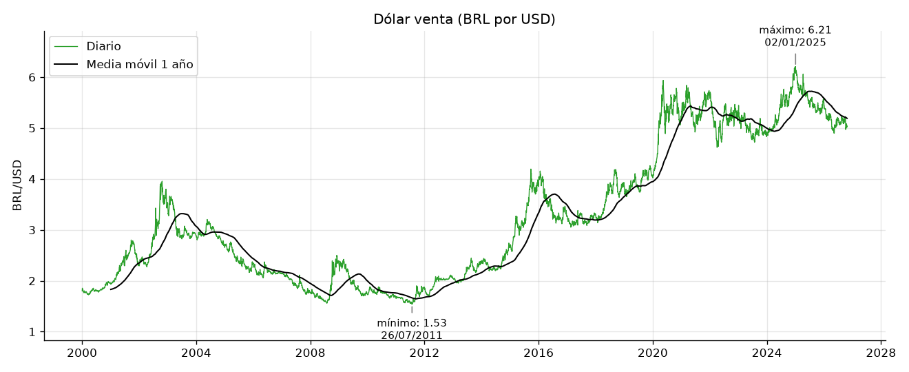

# panorama-brasil

Proyecto de punta a punta con datos públicos del **Banco Central de Brasil (BCB)**:
API → base de datos SQLite → notebook de análisis → dashboard.

## Series

| Código SGS | Serie | Frecuencia |
|-----------:|-------|------------|
| 432 | Selic meta (% a.a.) | diaria |
| 433 | IPCA, variación mensual (%) | mensual |
| 1 | Dólar venta (BRL/USD) | diaria (días hábiles) |

Fuente: API SGS del BCB, sin registro ni credenciales:
`https://api.bcb.gov.br/dados/serie/bcdata.sgs.{codigo}/dados?formato=json`

## Estructura

```
├── src/
│   ├── bcb_client.py   # descarga de series desde la API SGS
│   ├── db.py           # crea la base y carga los datos
│   └── consultas.py    # ejecuta por nombre las consultas de sql/consultas.sql
├── sql/
│   ├── schema.sql      # esquema de la tabla series
│   └── consultas.sql   # promedio anual, máximos/mínimos, variación mensual, IPCA anual
├── notebooks/
│   ├── analisis.ipynb  # análisis y gráficos
│   └── figuras/        # gráficos exportados en PNG
├── dashboard/
│   └── app.py          # dashboard de Streamlit
├── data/               # panorama.db (no se sube a GitHub)
├── requirements.txt
└── README.md
```

## Instalación

Requiere Python 3.11 o superior.

```bash
python3 -m venv venv
venv/bin/pip install -r requirements.txt
```

## Uso

Descargar las series y cargarlas en `data/panorama.db`:

```bash
venv/bin/python -m src.db                     # desde 2000-01-01 (por defecto)
venv/bin/python -m src.db --desde 2015-01-01  # desde otra fecha
```

La carga es **idempotente**: si la ejecutas otra vez, actualiza los datos pero no los duplica.

Abrir el notebook de análisis:

```bash
venv/bin/jupyter notebook notebooks/analisis.ipynb
```

Abrir el dashboard (se abre en http://localhost:8501):

```bash
venv/bin/streamlit run dashboard/app.py
```

El dashboard tiene tres pestañas:

- **Series:** último valor, máximo y mínimo de cada serie en el rango elegido, con su gráfico.
- **Selic vs. inflación:** Selic meta, IPCA acumulado en 12 meses y tasa real aproximada.
- **Promedio anual y datos:** tabla de promedios por año, datos filtrados y descarga en CSV.

En la barra lateral se eligen las series y el rango de fechas. Arriba a la derecha hay un selector de idioma: inglés (por defecto), portugués o español.







### Publicarlo en Streamlit Community Cloud

La base `data/panorama.db` no se sube a GitHub. Si el dashboard no la encuentra, descarga las series de la API y la crea; la primera visita tarda unos 2 minutos.

1. Entrar en https://share.streamlit.io con la cuenta de GitHub.
2. **Create app** → repositorio `panorama-brasil`, rama `main`, archivo `dashboard/app.py`.
3. En **Advanced settings**, elegir Python 3.12 y pulsar **Deploy**.

## Análisis







## Base de datos

Tabla `series`:

| Columna | Tipo | Descripción |
|---------|------|-------------|
| `codigo` | INTEGER | código de la serie en el SGS |
| `nombre` | TEXT | nombre legible |
| `fecha` | TEXT | fecha ISO `AAAA-MM-DD` |
| `valor` | REAL | valor numérico |

Clave primaria: (`codigo`, `fecha`).

Ejemplo de consulta:

```bash
sqlite3 data/panorama.db "SELECT fecha, valor FROM series WHERE codigo = 1 ORDER BY fecha DESC LIMIT 5;"
```

## Notas técnicas

- La API devuelve fechas `dd/mm/aaaa` y valores como texto; al cargar se convierten a fecha ISO y a número.
- La API acepta como máximo **10 años por consulta** en las series diarias, por eso la descarga se hace por tramos.
- Ante errores de red o respuestas vacías, se reintenta varias veces con espera creciente.

## Próximos pasos

- [x] `sql/consultas.sql`: promedio anual, máximos y mínimos, variación mensual
- [x] `notebooks/analisis.ipynb`: Selic vs. IPCA, evolución del dólar
- [x] `dashboard/app.py`: Streamlit con selector de serie y rango de fechas
- [x] Capturas del dashboard en el README
- [x] Subir a GitHub
